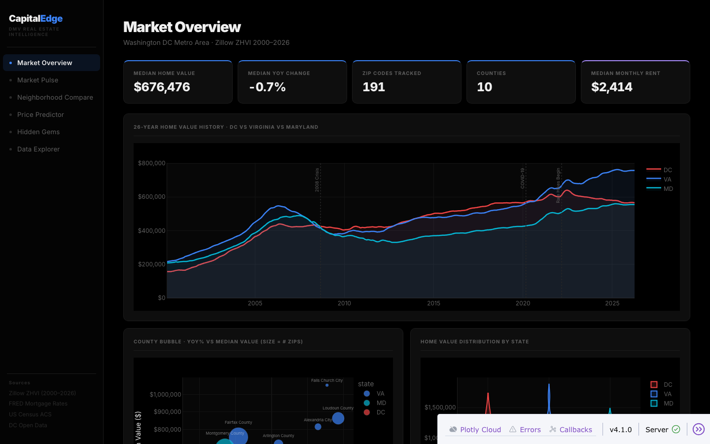
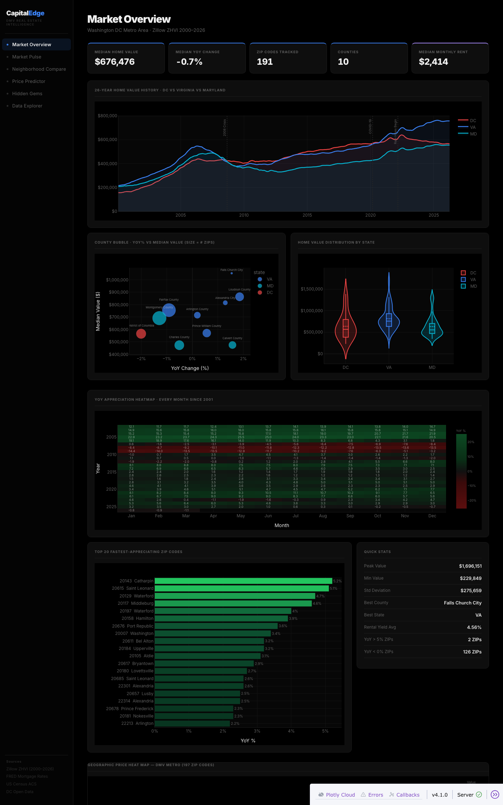

**CapitalEdge: DC Metro Housing Market Dashboard**

An interactive dashboard that tracks 26 years of home values across 191 ZIP codes in Washington DC, Maryland and Virginia.

Live dashboard: https://capitaledge-one.vercel.app

**The problem**

Home prices in the DC metro area move very differently from one county to the next. Zillow publishes the numbers, but not in a form that lets you compare neighbourhoods, see long term trends or spot where prices are rising or falling. CapitalEdge turns the raw monthly data into one dashboard.

**The data**

* Zillow Home Value Index by ZIP code, monthly from January 2000 to March 2026.
* Zillow rent values by ZIP code, available for 128 of the 191 ZIP codes.
* 30 year mortgage rates from FRED, the St. Louis Fed data service.
* Coverage: 10 counties and cities across DC, Maryland and Virginia, 57,335 monthly records.

The cleaned file is data/processed/master_dataset.csv. ZIP codes that were wrongly matched to Montgomery County in southwest Virginia were removed, because they are not part of the DC metro area.

**What the dashboard shows**

* Market Overview: median home value, yearly change, ZIP count, median rent, 26 year history by state, a county comparison and the spread of values by state.
* Market Pulse: mortgage rates and price momentum for context.
* Neighborhood Compare: any two ZIP codes side by side. Income, population and crime rows stay blank until Census data is added.
* Data Explorer: a searchable table of the full dataset.
* Price Predictor and Hidden Gems: planned pages. They need Census income and crime data and a trained model, which this version does not include yet.

**Findings from the data**

* Loudoun County, Virginia grew fastest over the last five years, at about 6.0 percent a year compounded (March 2021 to March 2026). Prince William County was next at 5.0 percent and Fairfax County grew 3.9 percent.
* DC is the exception: home values fell about 0.9 percent a year over the same five years. Arlington grew only 1.7 percent a year.
* Typical ZIP values in March 2026: a median home value of about 676,000 dollars and a median rent of about 2,414 dollars a month. The median yearly price change was minus 0.6 percent, so the market is flat to slightly down.
* Gross rental yield, annual rent divided by home value, has a median of 4.6 percent. It is strongly and negatively related to home value (correlation of minus 0.73), so cheaper ZIP codes give renters and landlords the highest yields.
* The county medians run from about 473,000 dollars in Charles County to over 1 million dollars in Falls Church City.

**Tech stack**

Python, Dash, Plotly, pandas, scikit learn and Flask, deployed on Vercel from this repository.

**Run it locally**

1. Create a virtual environment and install the packages in requirements.txt.
2. Run python src/app.py.
3. Open localhost on port 8050.

**Repository layout**

* app.py: the entry point Vercel uses
* src/app.py: the dashboard
* src/assets: the stylesheet
* data/processed: the two data files the app needs
* src/data_ingestion.py, load_data.py, cleaning.py and analysis.py: the full data pipeline, which uses PostgreSQL and a free Census API key
* sql: the schema and analysis queries
* requirements_pipeline.txt: extra packages for the pipeline

**Roadmap**

1. Add Census income, population and crime data.
2. Train a price model and use it to switch on Price Predictor and Hidden Gems.
3. Add EDA notebooks.

**Author**

Rutvij Reddy Vakati, MS in Data Analytics Engineering, George Mason University.
LinkedIn: https://linkedin.com/in/vakati-rutvij-1167rutvij
GitHub: https://github.com/rutvij1407
